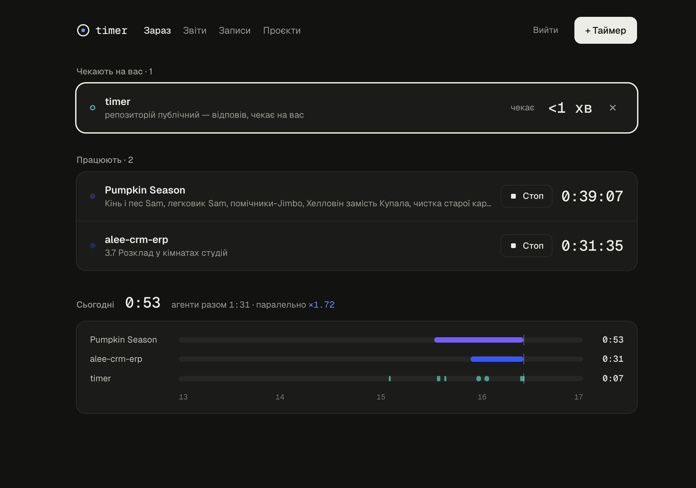

# Timer

Трекер часу для AI-агентів: кілька Claude Code паралельно — і чесна відповідь, скільки часу пішло на кожен проєкт.



- **Хуки Claude Code** самі запускають і зупиняють таймер: промпт → старт, кінець відповіді → стоп, запит дозволу → «чекає на вас», кожен виклик інструменту → heartbeat.
- **MCP-сервер** (`/mcp`) — задачі, звіти, ручний таймер і правки з Claude Code, claude.ai і Claude Desktop.
- **Веб-інтерфейс** — хто працює і хто чекає, звіти в трьох режимах, записи, проєкти й задачі.
- **Кілька користувачів** — вхід через GitHub або Google (обидва можна прив'язати до одного акаунта в «Налаштуваннях»); кожен бачить лише своє.
- **Cloudflare**: Worker + D1 + KV, Terraform для ресурсів, Wrangler для коду.

## Як підключитися (timer.kopachev.life)

1. Увійдіть через GitHub або Google на [timer.kopachev.life](https://timer.kopachev.life) → «Налаштування».
2. **claude.ai / Claude Desktop:** Settings → Connectors → Add custom connector → `https://timer.kopachev.life/mcp`. Вхід через GitHub, ключ не потрібен.
3. **Claude Code — одна команда** (хуки для обліку часу + MCP-сервер `timer`). У «Налаштуваннях» кнопка «Копіювати» сама створює ключ для хуків і підставляє його:

   ```bash
   curl -fsSL https://timer.kopachev.life/install-hooks.mjs | node --input-type=module - https://timer.kopachev.life tk_КЛЮЧ
   ```

   Потім перезапустіть Claude Code і введіть `/mcp` → timer → Authenticate — один раз увійти через GitHub.

Ключ у команді — «лише хуки»: він лежить у `~/.claude/settings.json` і не відкриває ні даних, ні MCP. Для MCP-клієнта без OAuth у «Налаштуваннях» → «Інші клієнти» можна створити повний ключ (заголовок `Authorization: Bearer tk_…`).

Прибрати хуки: `node install-hooks.mjs --remove`; MCP — `claude mcp remove timer -s user`. Відкликати ключ — у «Налаштуваннях»; там само видаляється акаунт з усіма даними.

**Приватність.** Трекер бачить назви папок, задач і час. Початок промпту зберігається лише якщо ви ввімкнете це в «Налаштуваннях». Ключі зберігаються як SHA-256, OAuth-токени — у KV лише як хеші.

## Як рахується час

| Режим | Що показує |
| --- | --- |
| Повний (`full`) | Кожен проєкт отримує весь свій час — це час роботи агентів. Сума може бути більшою за реальний час. |
| Ділений (`split`) | Відрізок, де паралельно йдуть k проєктів, ділиться на k. Сума = реальний час. |
| Фокус (`focus`) | Час іде проєкту, куди ви востаннє надіслали промпт (або запустили ручний таймер). |

**Реальний час** — коли йшов хоча б один запис. **Усі сесії разом** — сума часу всіх потоків роботи: кожна сесія агента, таймер задачі через MCP і ручний таймер проєкту — окремий потік, навіть в одному проєкті. **Паралельність** = усі сесії разом / реальний час: п'ять сесій, що годину йшли одночасно, — ×5. **Пік** — найбільше потоків одночасно.
Записи через північ діляться між днями у вашому часовому поясі («Налаштування»). Запущені записи входять у звіт «до зараз».

## Структура

```
src/index.ts      маршрути: вхід GitHub, /authorize (згода OAuth), /hooks/claude, /api/*, /mcp, cron
src/users.ts      користувачі, сесії (підписана cookie), API-ключі, GitHub і Google OAuth, прив'язка способів входу
src/service.ts    бізнес-логіка; кожен запит обмежений user_id
src/allocate.ts   розподіл паралельного часу
src/mcp.ts        MCP-інструменти
src/time.ts       межі днів/тижнів у часовому поясі
public/           веб-інтерфейс (без збірки) і install-hooks.mjs
migrations/       схема D1
infra/            Terraform: D1, Worker, KV
scripts/          smoke.sh, isolation.py (ізоляція користувачів + OAuth), chat-hook.sh
```

## Свій екземпляр

1. **GitHub OAuth App** (Settings → Developer settings → OAuth Apps): Homepage `https://<домен>`, callback `https://<домен>/auth/github/callback`.
   **Google** (необов'язково): Google Cloud Console → APIs & Services → Credentials → OAuth client ID → Web application, redirect URI `https://<домен>/auth/google/callback`; scopes `openid email profile`. Client ID — у `vars.GOOGLE_CLIENT_ID`, секрет — `wrangler secret put GOOGLE_CLIENT_SECRET`. Без них кнопки Google немає.
2. **Terraform** — база, Worker, KV:

   ```bash
   cd infra && cp terraform.tfvars.example terraform.tfvars   # account_id, hostname
   export CLOUDFLARE_API_TOKEN=...                            # права — у versions.tf
   terraform init && terraform apply
   ```

3. **wrangler.jsonc**: `routes[0].pattern` — домен; `database_id` — `terraform output -raw d1_database_id`; `kv_namespaces[0].id` — `terraform output -raw oauth_kv_id`; `vars.PUBLIC_URL`, `vars.OWNER_GITHUB_LOGIN`, `vars.GITHUB_CLIENT_ID`.
4. **Секрети, міграції, деплой:**

   ```bash
   npx wrangler secret put SESSION_SECRET        # openssl rand -base64 48
   npx wrangler secret put GITHUB_CLIENT_SECRET
   npm run db:migrate:remote && npm run deploy
   ```

`OWNER_GITHUB_LOGIN` — хто забирає дані, створені до появи акаунтів (міграція 0005), при першому вході.

## Локально

```bash
npm install
printf 'SESSION_SECRET=%s\nGITHUB_CLIENT_SECRET=dev\nPUBLIC_URL=http://127.0.0.1:8787\n' "$(openssl rand -base64 32)" > .dev.vars
npm run db:migrate:local
npx wrangler dev --local-upstream 127.0.0.1:8787   # вхід без GitHub: /auth/dev?login=alice (лише коли PUBLIC_URL з http://)
python3 scripts/isolation.py                       # два користувачі, чужі id → 404, MCP з ключем і через OAuth
python3 scripts/mcp-timer.py                       # таймер задач через MCP без хуків і з хуками
TIMER_KEY=tk_… npm run smoke                       # агенти, ручний таймер, звіт, MCP
npm test                                           # allocate + часові пояси
```

## Проєкти й задачі

**Проєкт** — папка/репозиторій: хуки самі створюють його за робочою директорією агента. **Задача** — конкретна робота в проєкті («LIN-42: експорт CSV»). Записи часу належать проєкту і, за бажанням, задачі.

Як агент працює із задачею:

1. `timer_task_add` (з `start: true`) або `timer_task_start` — задача переходить у «в роботі».
2. Одразу після виклику хук `PostToolUse` бачить, яка саме сесія його зробила, і прив’язує її до задачі. Час цієї сесії йде в задачу, зокрема в наступних ходах. Інші агенти в тому ж проєкті не зачіпаються.
3. `timer_task_done` — задача «готово»; поточний інтервал розрізається, далі сесія працює в проєкті без задачі.

Без хуків (claude.ai, Claude Desktop, хмарні сесії) час задачі рахує сам MCP: `timer_task_start` запускає таймер задачі, `timer_task_done` його зупиняє. Кілька задач одного проєкту можуть іти паралельно. Будь-який виклик MCP продовжує ці таймери; забутий таймер (4 год без жодного виклику) закривається на останньому виклику. Якщо ж хук прив'язав до задачі справжню сесію Claude Code, таймер MCP прибирається — час не рахується двічі. `timer_task_done` зупиняє все, що йде на задачі: сесії з хуками (вони продовжують у проєкт без задачі), таймер MCP і ручний таймер.

Проєкт для MCP визначається так: `project` → `repo` (вивід `git remote get-url origin`) → `cwd`. Хмарні сесії клонують репозиторій у тимчасові папки з довільними назвами (`/home/claude/alee-1718`), тому за такою папкою проєкт не створюється: без `repo` чи `project` MCP відповідає помилкою зі списком проєктів, і агент передає потрібний. Таймери задач продовжує лише виклик про той самий проєкт.

У веб-інтерфейсі задачі видно в розділі «Проєкти»: додати (`LIN-42: назва` — номер розпізнається), позначити виконаною, запустити ручний таймер на задачу, видалити (час лишається в проєкті).

## Веб-інтерфейс

- **Зараз** — «Чекають на вас» (агент закінчив хід або просить дозволу, скільки чекає; червоне після 10 хв), «Працюють» (агенти й ручні таймери з живим лічильником), шкала сьогоднішнього дня по проєктах.
- **Звіти** — період, режим (повний / поділ / фокус), реальний час проти «усі сесії разом» по днях, проєкти, задачі, експорт CSV.
- **Записи** — список із пошуком і панель правки: проєкт, задача, нотатка, початок і кінець; «Продовжити» запускає ручний таймер з тими ж даними.
- **Проєкти** — шляхи, статистика, задачі (в роботі / до роботи / готово за 7 днів), перейменування, злиття, архів.

Стан «чекає» дають хуки `Stop`, `StopFailure` і `Notification`; наступний промпт або виклик інструменту повертає агента в «працюють».

## MCP-інструменти

| Інструмент | Що робить |
| --- | --- |
| `timer_status` | Що йде зараз, з проєктом і задачею |
| `timer_report` | Звіт: period / from–to, mode, project; проєкти й задачі |
| `timer_task_list` | Задачі проєкту (cwd або project) з витраченим часом |
| `timer_task_add` | Нова задача; `start: true` — одразу почати |
| `timer_task_start` / `timer_task_done` | Почати / завершити задачу (id, номер у трекері або назва) |
| `timer_task_update` | Назва, нотатки, номер, статус; `delete: true` |
| `timer_label` | Підписати поточну роботу агента в проєкті (cwd + note) |
| `timer_start` / `timer_stop` | Ручний таймер (зустріч, дзвінок), за бажанням на задачу; `switch=true` зупиняє інші |
| `timer_entries` | Записи з id (фільтр за проєктом і задачею) |
| `timer_edit_entry` / `timer_add_entry` | Правка (зокрема проєкт і задача), видалення, додавання минулого запису |
| `timer_projects` | list / create / rename / add_path / remove_path / merge / archive / unarchive |

## Правила

- Проєкт визначається за `X-Project-Dir` (корінь сесії), інакше за `cwd`: найдовший прив’язаний шлях, що є префіксом, інакше новий проєкт із назвою папки. У проєкту може бути кілька шляхів (корінь, worktree); `merge` переносить шляхи, задачі й записи.
- Одна сесія агента в одному проєкті — один запущений запис; два агенти в одному репо рахуються у звіті як один проєкт.
- Ручні записи одного проєкту не перекриваються (зокрема після `merge`). Ручний запис коротший за хвилину не зберігається: стоп таймера його відкидає, а створити чи скоротити такий запис вручну не вийде.
- Нова тривалість рухає кінець запису, початок лишається (як у Toggl).
- Назви активних проєктів унікальні без урахування регістру; автоматично створений проєкт отримує «назва (2)», якщо назва зайнята.
- Час задачі у звіті — завжди «повний» (час агентів над нею); два агенти над однією задачею одночасно рахуються один раз.
- Кожен користувач бачить лише свої дані: усі запити до бази мають умову `user_id`, сесії агентів зберігаються з префіксом користувача. Перевірка — `scripts/isolation.py`.
- Зміни даних із браузера приймаються лише з того самого сайту (`Sec-Fetch-Site`); cookie сесії — `__Host-`, `Secure`, `HttpOnly`, `SameSite=Lax`.
- Список записів обмежений 1000 найновішими за період; UI і MCP кажуть, якщо щось не показано.

## Відомі обмеження

- Час між запитом дозволу (`Notification`) і вашою відповіддю не рахується; після відповіді запис відновлюється з наступним викликом інструменту. Якщо хуки встановлено до появи `Notification`, виконайте команду підключення з «Налаштувань» ще раз.
- Якщо модель думає довше `STALE_MINUTES` без жодного виклику інструменту, cron закриє запис раніше.
- Початок промпту (до 140 символів) зберігається як нотатка, лише якщо користувач увімкнув це в «Налаштуваннях» (за замовчуванням вимкнено).
